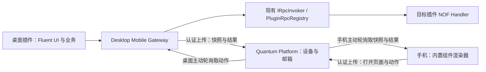
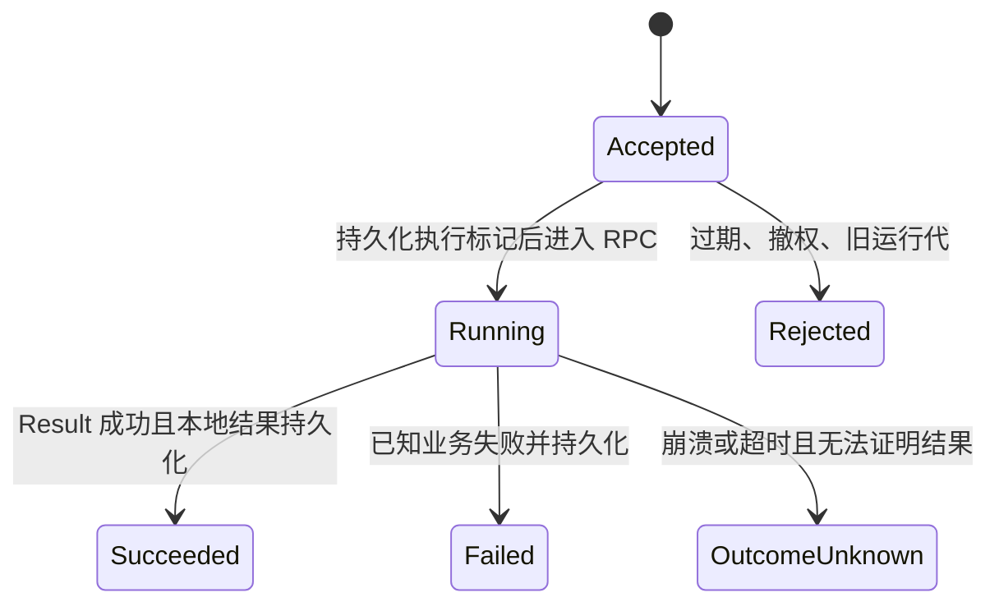

> 实现更新（2026-10-27）：同账号访问无需额外设备批准。手机先持久化完整命令并立即反馈，平台允许在原页面 5 分钟有效期内为临时离线桌面排队；打开请求仍为 30 秒。仅重投相同请求 ID，不重新执行结果未知的动作。正常关闭保留设备注册。下文中的首期禁止离线排队、额外设备批准及 30 秒业务命令期限已被该行为替代，当前使用说明见 `mobile/README.md`。

# NOF / Quantum 移动端技术设计稿

本文记录移动伴随客户端的架构目标。类型和示例用于说明设计；当前开发预览的具体实现及限制以 mobile/README 为准。

当前已交付开发预览。本稿保留完整目标设计；首版具体范围以 [mobile/README](../mobile/README.md) 为准。实际移动控制面使用 `/rpc/mobile`，避免与账号/市场 `/rpc` 的 NOF endpoint 冲突。

配套文档：[需求稿](mobile-requirements.md)。移动端只运行内置渲染器，业务执行保留在桌面插件中。

## 1. 现状与设计决策

仓库现有基础：

- 桌面 Host 是 `Quantum/quantum/src/Quantum`，当前仅有 Windows/macOS MAUI 目标和普通 `net10.0` 核心目标，不存在已实现的 Android/iOS 移动宿主。
- `.NET` SDK 的 `IRpcInvoker` 通过名称、JSON Payload、NOF Context/Result 调用插件；`PluginRpcRegistry` 支持完整名、短名与 Alias。插件间 RPC 目前不把 manifest 依赖关系当作权限。
- `PluginRpcInvoker` 绑定调用插件和运行代；目标调用使用独立 DI scope，停止/升级时撤销 endpoint 并处理在途调用，不能让移动桥接缓存插件 CLR 对象而阻止 ALC 回收。
- TypeScript SDK 与 iframe Host adapter 共享能力模型；新增移动声明能力必须同时覆盖两种 SDK 和 Host transport。
- Quantum Platform 已通过 NOF Contract/Application/Host 边界提供 `POST /rpc` JSON-RPC 2.0、平台账号和 JWT。`LoginResponse` 提供 AccessToken、过期时间和用户，当前该登录契约没有 RefreshToken。
- 桌面已有 `QuantumMarketplaceSession`，但它是市场会话，不是设备注册、手机授权或可靠消息中转能力。

核心决策：新增“数据化移动 UI 协议 + 桌面动作网关 + 平台双向邮箱”。桌面仍使用现有插件 RPC 处理业务，平台只暴露传输控制面的 RPC。原有本地插件 RPC 行为保持，新增的远程入口必须先通过更严格的动作授权。

旧路线图的“手机安装并执行 Web 插件”不适用于本设计。移动端二进制仅包含内置渲染器和网络/账号壳，不包含桌面 ALC、插件扫描器、iframe 插件运行时或任意代码解释器。

## 2. 部署与模块边界



图中返回箭头都是客户端发起轮询后的 HTTP 响应，平台不主动连接设备。

| 模块 | 拟议位置与职责 |
| --- | --- |
| 协议模型/校验 | `Quantum.Mobile.Internal`：框架内部通信模型与校验；公开 SDK 仅提供插件页面声明 API |
| 插件声明 SDK | .NET `Quantum.Plugin.Abstraction` 和 TypeScript SDK；Fluent builder、页面 provider、动作绑定 |
| 桌面桥接 | `Quantum/quantum/src/Quantum/Mobile`：页面生命周期、动作注册表、RPC 适配、设备授权、收发/去重 |
| 平台控制面 | `Quantum.Platform.Contract/Domain/Application`：设备、绑定、共享目录、消息、租约、配额和鉴权 |
| 平台持久化 | `Quantum.Platform`：PostgreSQL repository、事务、过期清理与可观测性 |
| 移动应用 | 建议独立 `Quantum.Mobile` 项目，MAUI Android/iOS 原生控件，不复用桌面启动组合根 |
| Renderer | 独立共享 MAUI 控件库，固定类型到控件的映射，供手机与桌面模拟器使用 |
| 模拟器 | SDK 配套桌面工具/开发面板，共用协议与 Renderer，经桌面网关使用 Mock/真实 transport |

这些是逻辑划分，是否另建仓库留到实施评审。共享协议不引用插件私有 DTO；平台不引用桌面宿主 ABI。移动 Release 不继承桌面 Catalyst 的 `UseInterpreter=true` 或动态加载设置。

## 3. Fluent API 与页面构造

### 3.1 .NET 概念示例

```csharp
// 以下类型均为拟议 API，不是当前可编译的 SDK。
var page = Mobile.Page("notes.quick", "快速记录")
    .Content(Mobile.VStack(
        Mobile.Text("记录一条笔记").Style(TextStyle.Title),
        Mobile.TextField("content").Placeholder("内容").MaxLength(500),
        Mobile.Toggle("pinned").Label("置顶"),
        Mobile.Button("保存").OnClick(
            Mobile.Rpc("save", "quantum.plugin.notes.notes.create")
                .Constant("notebookId", "inbox")
                .Input("text", "content")
                .Input("pinned", "pinned")
                .RefreshPageOnSuccess())));
```

SwiftUI 风格指声明、组合和修饰符语义；不引入 Swift 语法或手机端 closure。所有 builder、页面 provider 与结果处理回调在桌面执行。`OnClick` 不能接受一个要求移动端运行的任意委托。

provider 按页面会话构造快照，可读取插件服务和当前业务数据。业务状态变化时插件可通知页面失效；桌面合并刷新并重新生成全量快照。页面构造不得产生业务写副作用。provider 的签名包含取消令牌、语言、设备显示能力和只读会话信息，页面构造超时建议 5 秒。

同一动作可固定调用另一插件的 RPC；必须使用完整 `pluginId.service.method` 名称，发布时解析为确切 endpoint 和目标运行代。拒绝短名/Alias 的歧义选择，运行时目标变化时重新生成页面，不能静默改投另一个实现。

### 3.2 TypeScript 对齐

TypeScript 提供等价 `mobile.page(...).content(...)`、`rpc(...).constant(...).input(...)` builder。声明仍在桌面隔离 iframe 里运行；通过新增 `mobile.registerPage / unregisterPage / invalidatePage` capability 进入 Host。Host 校验 iframe 来源、插件和 runtime 所有权，provider 请求/响应由绑定 runtime 的消息通道关联并支持取消与卸载清理。

不得只添加 TS 类型。实施时同时交付 iframe 请求/响应、Host adapter、.NET 服务注入、协议 fixtures、错误传播和清理测试。两种 runtime 生成同一 JSON，差异只在桌面调用机制：.NET DI provider 与 iframe provider。

## 4. UI 协议与状态模型

### 4.1 快照结构

```json
{
  "schemaVersion": 1,
  "desktopDeviceId": "desktop-1",
  "desktopSessionId": "session-9",
  "pluginId": "quantum.plugin.notes",
  "pluginVersion": "0.1.0",
  "runtimeId": "runtime-a",
  "mobileDeviceId": "phone-1",
  "viewSessionId": "view-3",
  "pageId": "notes.quick",
  "revision": 12,
  "expiresAtUtc": "2026-10-19T04:05:00Z",
  "title": "快速记录",
  "root": {
    "type": "VStack",
    "id": "root",
    "children": [
      { "type": "TextField", "id": "content", "maxLength": 500 },
      { "type": "Button", "id": "save", "text": "保存", "actionId": "action-x" }
    ]
  }
}
```

传给手机的是展示树与不透明 actionId；RPC 名称、固定参数与参数映射保留在桌面注册表，不信任来自手机或平台快照的动作定义。节点 ID 在页面中唯一且由开发者稳定指定。采用有限枚举的排版、颜色和字体，不接受反射类型名、URL 资源、脚本、HTML、任意样式或表达式。

快照以 `(desktopSessionId, viewSessionId, revision)` 排序，revision 在同一会话内单调增长。收到旧 revision 或重复消息直接忽略；新 desktopSessionId 必须先重开页面，不能按字符串或时间比较不同会话的 revision。

首期仅全量快照，无 JSON Patch 和手机端业务状态机。控件草稿独立于已展示快照：重复投递不重置；收到新 revision 时若有脏草稿，先禁用旧动作并提示刷新，再替换树，不把旧草稿偷偷提交给新动作。

### 4.2 能力协商与资源上限

手机注册/打开页面上报协议范围、支持组件、locale、主题、字体缩放和显示尺寸档位。桌面只生成兼容组件；未知版本或必要组件不支持时返回宿主错误页，不尝试执行或静默忽略关键按钮。

拟议默认值：单快照不超过 128 KiB UTF-8、500 节点、深度 16；单字段不超过 2,000 字符，整体输入不超过 16 KiB；单消息不超过 256 KiB，超限结果返回受控错误而非截断为成功。客户端与服务端均限制解析深度与大小，避免只在 builder 校验。

第一期无外部图片/字体/附件与资源下载。Renderer 采用内置 MAUI 控件，布局验证包含安全区、键盘遮挡、滚动、无障碍名称、动态字体与主题；模拟器不能代替真机验证。

## 5. 设备、会话和授权

1. 复用平台 `Login` 获取用户令牌，先通过当前用户接口确认身份。新增独立的设备会话，不将硬件标识直接当身份凭证。
2. `RegisterMobileBridgeDevice` 注册 desktop/mobile 类型设备，返回设备 ID、短期设备凭据与会话 ID；凭据绑定平台用户、设备类型和会话，存入 OS 安全存储。
3. 每次中转调用须同时校验平台用户 Bearer 和设备凭据；平台从认证信息推导 userId 和 senderDeviceId，拒绝载荷冒充。令牌失效停止收发，MVP 重新登录，不假设现有 RefreshToken 能力。
4. 手机选桌面后申请绑定，桌面在本地确认设备名、申请时间与短验证码。确认只批准同账号的该设备对；未经确认不能读取页面正文或提交动作。
5. 桌面用户启用插件共享。平台保存共享策略及版本 `shareEpoch`；每次撤权递增，旧消息携带的 epoch 不再有效。
6. 每次消息提交、领取和桌面执行前都复核授权。撤销清除未领取消息、页面引用和会话；桌面停止本机执行入口。手机不可借管理员角色跨账号读取内容。

设备凭据与用户 token 分离，是为了设备注销可即时拒绝后续中转，而无需等待已有用户 JWT 自然过期。设备 ID 不是秘密；平台必须具备服务端可撤销记录。平台地址切换使用独立凭据、设备 ID 和缓存命名空间。

桌面进程重启产生新 desktopSessionId；本地持久化去重记录继续保留，旧 session 的动作全部失效。移动进程重启先查询待确认 requestId，再创建新 viewSession，不重放缓存按钮。

## 6. 平台中转协议

### 6.1 控制面 Contract 草案

沿用 `POST /rpc`、`params` 直接承载请求和 NOF Result envelope。以下方法名为拟议新 Contract，不表示已有接口；可以组织在独立服务契约中，避免把手机交互塞进插件市场服务。

| 方法 | 主要输入 / 返回 | 调用约束 |
| --- | --- | --- |
| RegisterMobileBridgeDevice | 设备名、类型 / 设备凭据、session | 已登录用户 |
| ListMobileBridgeDesktops | 空 / 账号内桌面与在线状态、绑定状态 | 已注册手机 |
| RequestMobileBridgeBinding | desktopDeviceId / bindingId、验证码、有效期 | 同账号手机 |
| ResolveMobileBridgeBinding | bindingId、approve / 绑定状态 | 目标桌面及本地确认 |
| SetMobileBridgeSharing | 插件共享集合、预期 shareEpoch / 新 epoch | 桌面 |
| ListMobileBridgePages | desktopDeviceId / 共享页面目录 | 已绑定手机 |
| PublishMobileBridgeCatalog | 插件运行代、页面元数据 / 目录版本 | 桌面，不含业务正文 |
| PublishMobileBridgeSnapshot | 目标手机/会话、revision、快照 / 引用 | 桌面，原子更新最新快照与通知 |
| GetMobileBridgeSnapshot | viewSessionId、已知 revision / 最新快照或未变化 | 对应手机 |
| SendMobileBridgeMessage | targetDeviceId、messageId、kind、body / 接收回执 | 受控消息方向及正文校验 |
| PollMobileBridgeMessages | batchSize / 消息、leaseToken、serverTime | 仅本设备邮箱 |
| AckMobileBridgeMessages | 消息 ID、leaseToken / 确认结果 | 仅持有本设备租约者 |
| GetMobileBridgeActionStatus | requestId、desktopDeviceId / 当前状态及受限结果 | 原始手机；允许重启后查询 |
| RenewMobileBridgeHeartbeat | 当前 session / 服务端时间、有效期 | 当前设备 |
| RevokeMobileBridgeDevice / Binding | 设备或绑定 ID / 完成 | 所有者，立即服务端撤销 |

共享目录由桌面发布，插件停用后撤销，目录具有心跳和 epoch，不从市场推断“已安装”。打开/关闭页面通过邮箱消息交给桌面创建/释放 viewSession；首次打开先由平台分配并登记会话所有权，桌面收到后验证并生成快照。`GetSnapshot` 仅取已存在内容，不替代桌面生成。

### 6.2 Envelope 与消息种类

```json
{
  "messageId": "m-101",
  "correlationId": "request-52",
  "targetDeviceId": "desktop-1",
  "kind": "InvokeAction",
  "body": {
    "desktopSessionId": "session-9",
    "viewSessionId": "view-3",
    "revision": 12,
    "shareEpoch": 4,
    "actionId": "action-x",
    "inputs": { "content": "示例", "pinned": false }
  }
}
```

`messageId` 用于传输去重，`correlationId/requestId` 用于一次逻辑动作。平台生成并返回 senderDeviceId、ownerUserId、单设备 sequence、createdAtUtc、expiresAtUtc，客户端不能覆盖。平台按 kind 设定过期策略，不接受客户端无限延期。

允许种类：手机到桌面 `OpenPage / ClosePage / RefreshPage / InvokeAction`；桌面到手机 `PageReady / PageInvalidated / ActionStarted / ActionCompleted / ActionFailed / ActionOutcomeUnknown`。正文遵循 kind 对应 schema，不接受透传任意平台方法或任意 RPC。

`ActionCompleted` 等消息是带 requestId 的状态通知；结果与状态也按 requestId 存在平台，避免通知丢失后无法恢复。平台验证状态推进权限和终态不可覆盖；手机处理乱序时不允许 Started 覆盖 Completed。

### 6.3 短轮询与在线状态

- 本期使用有界短轮询，每次请求立即返回已有消息；每设备只有一个接收循环。两个方向相同，不依赖驻留连接。
- 活跃手机和开启共享的桌面默认间隔 2 秒，添加 ±20% 抖动；每批最多 50 条。空批也按间隔等待，不忙轮询。
- 非交互页面可退到 10 秒；断网或服务失败按 2、4、8…最高 60 秒退避。遵守服务端限流与建议重试时间。
- 心跳默认 15 秒，45 秒未成功心跳视为离线；使用平台时间，避免依赖设备时钟。手机每次提交仍须接受桌面最终校验，不能只相信在线标志。
- 移动退后台暂停正常轮询；回前台立即轮询并复核授权/页面，后台执行不能作为正确性前提。
- MVP 不设置“桌面离线也先排队以后执行”的模式。平台在线检查只是首层，桌面执行前继续检查 session、页面和动作截止时间。

2 秒轮询意味着每个活跃设备约 0.5 次接收请求/秒，10,000 个活跃设备约 5,000 次/秒，另计心跳和业务请求；上线前必须压测索引、空轮询开销与连接池。首期不引入长轮询；若以后评估，仍须保持相同消息语义。

## 7. 可靠投递与动作执行

### 7.1 邮箱可靠性

消息保证有限保留期内至少一次投递，不承诺全局顺序。平台在数据库事务中领取待投递消息，发放默认 30 秒租约；只有持租约的本设备可 Ack。未 Ack 的消息租约到期后重投。按设备 sequence 排序返回，但客户端必须用 revision/request 状态处理乱序。

接收端先把命令/结果写入本地持久化 inbox，提交成功再 Ack，然后异步处理；不能“刚收到就 Ack”。平台对 `(senderDeviceId, messageId)` 唯一约束，正文哈希不同却复用 messageId 时拒绝。租约令牌不可跨消息或设备使用。

快照是按会话保存的最新值，不是无限增长的页面更新消息队列；PublishSnapshot 在同一事务更新最新 revision 并写通知，可合并未领取的同会话通知。通知只携带会话和 revision，丢失或过期后手机通过 GetSnapshot 恢复。

### 7.2 固定动作注册表

桌面维护只含 Host 稳定类型的记录：

```text
ActionBinding = {
  actionId, ownerPluginId, ownerRuntimeId,
  targetQualifiedRpcName, targetPluginId, targetRuntimeId,
  desktopSessionId, mobileDeviceId, viewSessionId, revision, shareEpoch,
  constantArguments, allowedInputMappings, inputSchema,
  expiresAt, timeout, refreshPolicy
}
```

actionId 使用不可预测随机值，真正权限依赖完整记录匹配；不是可转让的 bearer capability。新 revision 原子替换快照和动作注册表，旧 revision 立即拒绝。发布上传失败可能导致手机短暂仍看见旧快照，此时提示刷新，不能回退授权。

按钮参数合成仅支持 `Constant(field, JSON)` 与 `Input(targetField, nodeId)`。固定字段和输入目标不得重叠；不支持字符串模板、JSONPath、函数、属性链执行或动态 RPC 名称。手机只提交声明的控件 ID，桌面验证类型、必填、长度和枚举后组装 DTO JSON，并再次使用目标 RPC 输入 schema 校验。客户端不能改固定 notebookId 等隐藏参数。

### 7.3 接入现有插件 RPC

1. 从本地 inbox 取命令，校验平台来源、用户、设备绑定、共享 epoch、消息截止时间、desktopSession 和页面 revision。
2. 通过 actionId 查 Host 注册表，确认拥有页面的插件及目标 RPC 所属插件均在正确运行代且可调用。
3. 持有运行代调用租约并进入与现有停止流程共用的调用计数；不能先校验后跨热切换调用新的 endpoint。
4. 以声明页面的插件身份进入同一个 `IRpcInvoker / PluginRpcRegistry / PluginRpcRuntime` 调用路径。新增 Host 内部适配器负责原始 JSON 与 `Result / Result<T>`，不需要获取目标私有 CLR DTO，也不开放移动原始 invoker。
5. Host 注入现有 callerPluginId/runtimeId，并增加受保护的远程来源 context：userId、desktopDeviceId、mobileDeviceId、requestId、viewSessionId。手机传入的 Context 一律不透传；远程来源不可覆盖。
6. 目标 NOF Handler 按既有独立 scope、JSON 边界、Result 错误语义执行。业务授权仍由 Handler 负责，远程网关校验不能替代业务规则。
7. 结果先持久化到桌面 outbox，再上传到平台；业务成功后重新生成该页面。结果状态和刷新结果分开，页面刷新失败不能把已完成业务显示为执行失败。

远程“同通道”指业务分发复用 Quantum RPC，不意味着把 Quantum RPC 目录原样公网暴露。受保护的 context 扩展同时进入 .NET/TS 文档与契约测试。

### 7.4 去重、崩溃与未知结果

逻辑动作键为 `(desktopDeviceId, mobileDeviceId, requestId)`。桌面本地持久化唯一记录，并记录绑定摘要和输入哈希；相同 ID 不同内容返回冲突。一个页面会话的动作串行处理，手机在途禁用只是体验，桌面也强制互斥。



默认策略：重复命令只查询/重发既有结果，不再次调用 RPC；平台已接收不表示执行成功。本地进入 Running 必须先落盘，重启发现 Running 则转为 OutcomeUnknown。此策略可能在“标记 Running 后尚未调用”时保守地报未知，但避免自动重复写入。

RPC 写入与桥接状态不共享事务，不能承诺 exactly-once。业务成功后桌面可能在落盘结果前崩溃；手机超时也不意味着操作被取消。取消令牌是尽力取消，不能撤销已经提交的副作用。30 秒动作期限经过后不再新启动；已经 Running 的调用超过执行期限则进入结果待确认/未知，不自动重做。迟到的明确结果可以使未知状态收敛，已知终态不可回退。

首期不自动重试已进入 Running 的动作。若业务未来要求重试安全，由该 RPC 用 requestId 实现业务幂等并持久化结果，再单独增加显式能力声明。用户手动再次操作属于新动作，未知时须提示先检查业务状态。

## 8. 持久化、生命周期与数据清理

平台建议新增以下独立领域对象，不混用插件发布队列：

| 对象 | 关键约束 |
| --- | --- |
| BridgeDevice / Session | user、设备类型、凭据摘要、会话、撤销时间、最后心跳 |
| BridgeBinding | user + desktop + mobile 唯一有效绑定，Pending/Approved/Revoked |
| BridgeShare | desktop + plugin、enabled、shareEpoch |
| BridgePageCatalog | desktopSession + plugin/page、runtime、目录版本、有效期 |
| BridgeViewSnapshot | user、设备对、viewSession、最新 revision、限额正文 |
| BridgeMessage | sender、recipient、sequence、kind、body、租约、到期、Ack |
| BridgeActionStatus | 原始设备对 + requestId 唯一、输入摘要、状态、结果引用 |

PostgreSQL inbox 查询索引覆盖 recipient、状态、nextVisibleAt、sequence；所有查询包含 owner/设备范围。消息写入、状态更新和 outbox 通知在同一数据库事务完成。支持多平台实例领取，不能依赖单机内存锁。设备/账号删除同时撤销绑定并清理业务正文。

桌面使用 Host 自有 SQLite 表保存 inbox、动作状态和 outbox，不写入插件业务库。结果落盘与 outbox 发送记录原子提交；网络失败只重传消息，不重复业务。桥接仅存 JSON/稳定值，provider 委托按运行代注册并在停止时解除。

拟议默认保留策略：

- 打开/刷新请求 30 秒、InvokeAction 未启动期限 30 秒；过期不再领取执行。
- 页面有效期 5 分钟，桌面在线且会话活跃时重新生成或续发新 revision；心跳不自动延长旧 actionId。
- 页面关闭或 10 分钟不活跃后清除正文与动作；手机返回时重开会话。手机前台每 30 秒更新所打开会话的活跃租约，不按 UI 2 秒轮询频率重发业务刷新。
- 平台结果正文和通知最多 24 小时；去重/终态元数据保留 7 天，之后仍拒绝原过期命令。桌面 inbox/outbox 与去重元数据至少覆盖相同窗口。
- 平台过期 Worker 按批清理，读取/执行路径同时校验到期，不能依赖清理任务及时运行才能保证权限。
- 手机缓存仅限当前账号、平台和已授权桌面，使用应用私有受保护存储；敏感输入草稿首期仅在内存，退出即清。

停用/升级先关对应动作入口，再等待已进入 RPC 的调用按现有运行代生命周期结束，移除 provider 和动作引用。目标或拥有页面的 runtime 任一切换，都撤销旧会话动作。新 runtime 发布新目录，手机必须重新开页；不把旧请求迁移到新版本。

关闭移动访问、退出登录或撤销设备时取消轮询、关闭本地执行网关、删除动作绑定、清理本机缓存，并向平台撤销会话。离线退出仍立即执行本机清理，远端可见状态靠会话过期失效；手机授权校验不能只依赖收到撤销通知。

## 9. 模拟器设计

模拟器作为 SDK 的正式开发工具，与手机共用 Renderer、schema 校验和动作请求模型。

- 预览模式：读取 fixture 或本机插件经 provider 生成的快照；Mock RPC 默认开启，明确显示模式。
- Host 联调模式：经本机 Host 网关创建测试设备/页面会话，仍执行 actionId、输入、运行代与去重校验；显式启用真实 RPC，避免预览误写业务数据。
- 平台联调模式：以模拟手机设备正常登录、授权、上传和轮询，验证完整中转链路；不创建未登录上传旁路。
- 故障注入：延迟、重复消息、乱序、过期、断网、平台暂不可用、目标重启与热升级。
- 显示快照 revision、会话、控件树、校验错误及脱敏 request 状态；不输出凭据或默认展开原始敏感参数。
- 预设常见手机尺寸、深色模式、字体缩放和键盘遮挡检查；真实 iOS/Android 的权限、进程回收和商店行为另行验证。

## 10. 错误与可观测性

拟议错误码：`mobile_auth_required`、`mobile_device_revoked`、`mobile_binding_required`、`mobile_sharing_disabled`、`mobile_desktop_offline`、`mobile_protocol_unsupported`、`mobile_payload_too_large`、`mobile_view_stale`、`mobile_action_expired`、`mobile_action_not_allowed`、`mobile_input_invalid`、`mobile_request_conflict`、`mobile_busy`、`mobile_result_unknown`、`mobile_rate_limited`。

目标 RPC 的已有错误 Result 原样保留结构，通过受控文案展示，不转成传输成功；异常栈不发送到手机。平台 JSON-RPC 成功返回还需检查 NOF `result.isSuccess`，平台接收回执、RPC Result 和页面刷新状态是三个独立层次。

通过 correlationId/requestId 关联平台接收、桌面领取、网关拒绝、RPC 耗时和结果上传。指标包括轮询 QPS/空批率、队列延迟、消息重复、过期、未知结果、快照大小、授权拒绝、outbox 积压与清理滞后。普通日志无正文。平台为每用户/设备设置并发、队列条数和字节配额，初始建议每设备最多 1,000 条或 10 MiB，满额明确拒绝，不能静默丢弃动作。

## 11. 实施拆分与验证计划

以下为评审后的建议顺序，当前不执行。

| 阶段 | 交付 | 验收 |
| --- | --- | --- |
| D0 | 协议、权限、错误、审核路径与 fixtures 定稿 | 两份稿件评审，明确商店验证责任与展示场景 |
| D1 | 平台设备/绑定/共享、认证邮箱、租约、状态与清理 | 两模拟客户端在不同网络完成投递，跨账号/设备拒绝 |
| D2 | .NET/TS builder、provider transport、桌面动作网关 | 同一动作走现有 RPC，输入篡改/重复/升级均受控 |
| D3 | 基础 Renderer、移动壳与模拟器 | 同一 fixtures 在模拟器、Android、iOS 上呈现一致语义 |
| D4 | 端到端恢复、负载、真机生命周期和发布材料 | 无入站端口闭环、故障矩阵、秒级延迟目标与审核验证 |

必须覆盖的契约和集成场景：

1. .NET/TS 生成相同 schema，Host adapter 实际可用；非法节点/属性/深度/输入均拒绝。
2. 未登录不可上传/轮询；伪造 sender、读别人的邮箱、复用其他设备租约及已撤销凭据均失败。
3. 不存在移动端任意 RPC 入口；改 actionId、revision、目标、固定参数和 Context 不能越权。
4. 业务调用使用真实 NOF Handler、独立 scope、JSON Result，跨插件调用与完整 endpoint 固定有效。
5. 重复投递、Ack 丢失、平台多实例、outbox 上传失败和终态通知乱序不会重复业务或回退终态。
6. 在 Running 标记前后、RPC 提交后、结果落盘后分别注入崩溃，验证拒绝/未知/结果重发语义。
7. 页面所有者或目标热升级、停止失败回滚、授权撤销均不产生旧动作投到新 runtime；ALC 可回收。
8. 2 桌面 × 2 手机隔离；断网、休眠、token 失效、手机退后台/进程回收、平台重启可恢复。
9. 基础控件在真机验证主题、字体、无障碍、键盘、安全区；Release 无动态插件代码加载路径。
10. 记录目标并发下的 P95、数据库负载、带宽和平台存储，验证配额与超期清理。

## 12. 评审重点

本稿建议冻结：只下发数据、固定动作网关、同账号加设备绑定、短轮询、全量快照、输入显式映射、运行代固定、未知结果不自动重做，以及 SDK 双 runtime 同步交付。

仍需验证的主要事项是 App Store 对产品分类的接受程度、MAUI 原生 Renderer 的跨端表现，以及轮询在预期规模下的成本。商店规则来源与限制见[需求稿第 9 节](mobile-requirements.md#9-发布前验证与待评审选择)，这些验证不改变本期“先设计、不实现”的交付边界。
